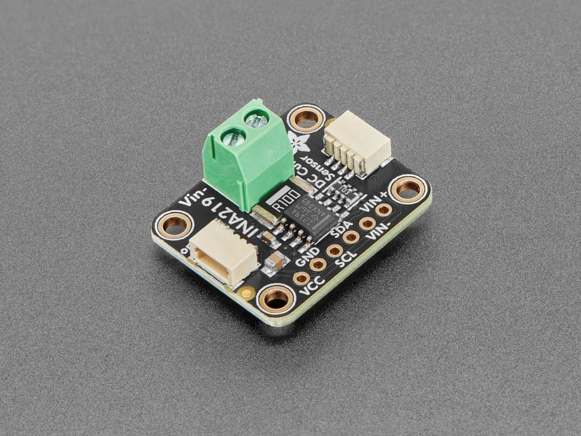

# mcu-powermon

Measure bus voltage, current and power over I2C with a TI INA219, INA226, INA228 or INA237. The INA228 also measures accumulated energy and charge.

**Platforms** · ESP-IDF 5.2+ and STM32 HAL. Hardware testing is pending. The host tests use simulated devices.

## Contents

- [Quick start](#quick-start)
- [Models and examples](#models-and-examples)
- [Using the library in your project](#using-the-library-in-your-project)
- [License](#license)

## Quick start

The example enables an INA226. Match `SHUNT_OHMS` to the resistor on your board and `MAX_CURRENT_A` to the current range you want to measure. Check the part and board voltage ratings before connecting a load.

In a terminal with ESP-IDF activated, get the example and select the target for an ESP32. Change the target if your board uses another ESP32 chip.

```sh
git clone https://github.com/JonasAtelier/mcu-powermon.git powermon
cd powermon/examples/esp/ina2xx
idf.py set-target esp32
```

Check the [wiring guide](docs/hardware.md) and edit the settings in [main.c](examples/esp/ina2xx/main/main.c) to match your board. Connect the board by USB, then build, upload and open the serial monitor.

```sh
idf.py build flash monitor
```

The monitor prints readings in volts, amperes and watts. If you change the chip, change both `MODEL` and the enabled driver in `sdkconfig.defaults`.

<details>
<summary>STM32 HAL example for an initialised bus</summary>

Initialise the bus in your application, then probe the sensor and read it.
This STM32 helper assumes the passed I2C handle is already initialised. The
part converts continuously, so a read never waits.

```c
#include "ina2xx.h"
#include "powermon.h"
#include "powermon_log.h"

int read_once(I2C_HandleTypeDef *bus)
{
    static const ina2xx_config_t cfg = {
        .model         = INA226,
        .shunt_ohms    = 0.1f,
        .max_current_a = 3.2f,
    };
    struct powermon_dev pm = { 0 }; /* Must start zeroed. */
    struct powermon_sample sample;
    int ret = ina2xx_probe(&pm, bus, &cfg); /* 0x40 */
    if (ret)
        return ret;

    ret = powermon_read(&pm, &sample);
    if (!ret)
        powermon_log_sample(&pm, &sample);

    ina2xx_remove(&pm);
    return ret;
}
```

</details>

## Models and examples

All four monitors measure bus voltage, shunt voltage, current and power. The INA237 and INA228 also report die temperature, and the INA228 accumulates energy and charge. Set `MODEL` to match your chip and use `powermon_read()` to read its measurements. [Shared API](include/powermon.h) · [Measurement fields by model](docs/chips.md#what-each-model-reports)

| Models | Driver header | ESP-IDF project | STM32 HAL example |
|---|---|---|---|
| INA219, INA226, INA228, INA237 | [ina2xx.h](include/ina2xx.h) | [Configurable I2C monitor](examples/esp/ina2xx/) | [Configurable I2C monitor](examples/stm/ina2xx/main.c) |

## Using the library in your project

- Add the component and enable the driver for your hardware. [Installation and build options](docs/installation.md)
- Open the ESP-IDF project for your hardware, or copy the STM32 example into a project with board setup already in place. [All ESP-IDF examples](examples/esp/) · [All STM32 examples](examples/stm/)
- Look up calls and chip-specific settings. [API usage](docs/usage.md) · [Hardware reference](docs/chips.md)

To run the simulated tests on your computer, run `make -C test test` from the library root. [Test requirements and coverage](docs/development.md)

## License

© 2026 JonasAtelier, [GPL-3.0-only](LICENSE)

<p align="center">
  
  <br><sub>Adafruit INA219 breakout &mdash; photo <a href="https://www.adafruit.com/product/904">Adafruit Industries</a></sub>
</p>

[Browse the workshop catalog · ESP32 and STM32 drivers](https://github.com/JonasAtelier/jonas-atelier-libraries#esp32-and-stm32-drivers)
